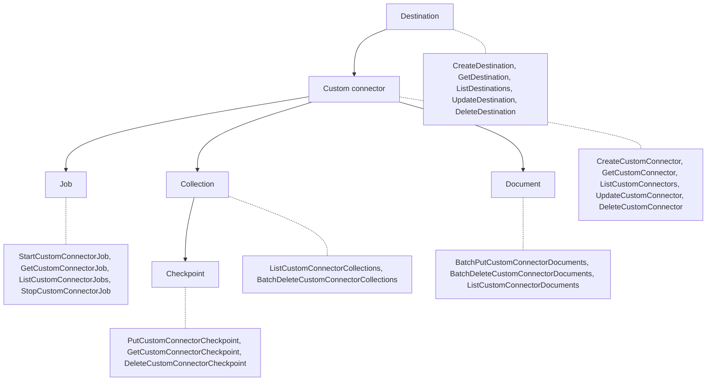

# Design

The Custom Connector Framework (CCF) runs connector code that the framework
doesn't trust, in the service account, against resources the tenant owns
in its own account. Most of the design follows from that: which role reaches
which account, what the backend guarantees, and what the toolkit does for the
connector. The terms below are the ones every other page uses. The
[README](./README.md) has the walkthrough, the
[administrator guide](./docs/administrator-guide.md) covers deploying and
operating, and the [user guide](./docs/user-guide.md) covers the API and writing
a connector implementation.

## Glossary

Examples use `111122223333` as the tenant account and `444455556666` as the
service account.

| Term | Definition | Example |
| --- | --- | --- |
| Source | The system a connector implementation reads. | GitHub |
| Connector implementation | The code for one kind of source: a `ConnectorImplementation` subclass, packaged as a container image in the tenant's connector image repository. | The GitHub connector image `111122223333.dkr.ecr.us-east-1.amazonaws.com/ccf-connectors/github:<asset hash>` |
| Connector project | A CDK app that deploys one connector implementation: a `CustomConnectorProject`, which builds the image into its repository, an existing destination it writes to, and one custom connector per source. | The `GitHubCustomConnector` stack in `111122223333` |
| Connector image repository | An Amazon ECR repository in the tenant account, named `ccf-connectors/<name>` and created by the connector project's `ConnectorImage`, that holds the project's connector images. Its repository policy lets only the Batch execution role pull. | `ccf-connectors/github` in `111122223333` |
| Custom connector | A registered, configured instance of a connector implementation that reads a source into a destination and holds its jobs. | `cc-e020d65d76c0`, named `github-awslabs`, runs the GitHub image with `{"owner": "awslabs", ...}`, a token secret, a weekly schedule, and its source-access role, and writes to `dst-7c41e9a2b5d0` |
| Destination | A tenant-owned resource in the tenant account: a bucket and, for type `BEDROCK`, a knowledge base and data source that read only that bucket. Types `S3` and `QUICK` are a bucket only. | `arn:aws:ccf:us-east-1:111122223333:destination/dst-7c41e9a2b5d0`, type `BEDROCK` |
| Destination stack | The framework app's stack for one destination, `CustomConnectorDestinationFor<Name>`: the destination's role, its boundaries, and the destination. | `CustomConnectorDestinationForGitHub` in `111122223333` |
| Tenant account | The AWS account that owns destinations, registers custom connectors, and holds the source-access role and each destination's role. | `111122223333` |
| Service account | The AWS account where the framework is deployed. | `444455556666` |
| Job | One run of a custom connector. | `ccj-5b8e0d2c41f9` |
| Collection | An optional group of documents in one custom connector, with an optional checkpoint. Its ID is `col-` plus 16 hex characters of the SHA-256 of the implementation's source collection ID, which the collection record also stores. Documents that name no collection go to `col-default`. | `col-3f9a1c2b5d7e9f01`, the files of GitHub repository 630587223 (source collection ID `630587223`) |
| Collection checkpoint | A string the connector implementation keeps for one collection, often JSON, up to 16 KB. The toolkit stores and returns it and never reads it. `col-default`'s checkpoint is the custom connector's own checkpoint. | `{"pushed_at": "2026-10-30T18:22:04Z", "filters": "a41f"}` |
| Document | One file the connector implementation hands over, stored with a metadata file in the destination bucket. Its ID is `doc-` plus 16 hex characters of the SHA-256 of the implementation's source document ID. | `doc-8d41e07a9c3f2b6e`, from source document ID `630587223/README.md` |
| Document ARN | The identifier of a document everywhere. | `arn:aws:ccf:us-east-1:111122223333:destination/dst-7c41e9a2b5d0/custom-connector/cc-e020d65d76c0/collection/col-3f9a1c2b5d7e9f01/document/doc-8d41e07a9c3f2b6e` |
| Source version | An optional string from the source that the toolkit stores with a document and returns, and never reads. | The git blob SHA `3b18e512dba79e4c8300dd08aeb37f8e728b8dad` |
| Content hash | The toolkit's SHA-256 of a document's bytes and metadata, used to skip rewriting an identical file. | `sha256:9f2c...` |
| Metadata file | The `<file>.metadata.json` file stored beside a document that holds its attributes for Bedrock or Amazon Quick. | `README.md.metadata.json` |
| Document prefix | The S3 key prefix that holds one document's file and metadata file in the destination bucket, labeled with the custom connector, collection, and document IDs from the document ARN. | `connector_id=cc-e020d65d76c0/collection_id=col-3f9a1c2b5d7e9f01/document_id=doc-8d41e07a9c3f2b6e/` |
| Source-access role | An IAM role in the tenant account that the custom connector's runtime role assumes, with the external ID, to read the custom connector's secret, write and delete files under the custom connector's prefix in the destination bucket, and read anything else in the tenant account the connector implementation needs. | `arn:aws:iam::111122223333:role/CcfSourceRole-github-awslabs` |
| Log destination | The custom connector's optional `log_destination`: a CloudWatch Logs log group in the tenant account and the log-delivery role that writes to it. Without one, nothing the container prints is kept. | `{"type": "CLOUDWATCH_LOGS", "arn": "arn:aws:logs:us-east-1:111122223333:log-group:/ccf/connectors/github-awslabs", "role_arn": "arn:aws:iam::111122223333:role/CcfLogDeliveryRole-github-awslabs"}` |
| Log-delivery role | An IAM role in the tenant account that the job's log router assumes, as the runtime role and with the external ID, to write the container's output to the log destination's log group. | `arn:aws:iam::111122223333:role/CcfLogDeliveryRole-github-awslabs` |
| Access control list | An optional list on a document (`USER` and `GROUP` entries with `ALLOW` or `DENY`) that the store writes into the metadata file, in Bedrock's format for an ACL-enabled `BEDROCK` destination and in Amazon Quick's format for `QUICK`. | `[{"principal_id": "dev@example.com", "principal_type": "USER", "access": "ALLOW"}]` |
| External ID | A value in the source-access role's and log-delivery role's trust policies that stops anyone from tricking the framework into assuming the role for them (the confused deputy problem). The framework generates one per custom connector. | `ccf-ext-2f9d41c7a8b04e1f9c3d5a6b7e8f9012` |
| Destination role | The role in the tenant account, one per destination, that the framework's destination workflow, connector deletion workflow, API Lambda, and ingestion consumer assume to create and delete that destination's infrastructure, delete documents' files, and start ingestion. | `arn:aws:iam::111122223333:role/ccf/destinations/CcfDestinationRole-GitHub` |
| Batch execution role | The framework role AWS Batch uses before the containers start, to pull the connector image from the tenant's repository and write the log router's own diagnostics. | `arn:aws:iam::444455556666:role/ccf/CcfBatchExecutionRole` |
| Runtime role | The role the framework creates for each custom connector; the job's containers run as it. Its name is `CcfConnectorRuntime-` plus the first 32 hex characters of the SHA-256 of the tenant ARN prefix and connector ID, so the name alone doesn't reveal the custom connector. | `arn:aws:iam::444455556666:role/ccf-runtime/CcfConnectorRuntime-3c9e1f0a2b7d4e6f8a1b2c3d4e5f6a7b` |
| Toolkit | The `custom_connector_framework` Python package and the CDK constructs that `framework/cdk/lib/index.ts` exports. | `from custom_connector_framework import ConnectorImplementation` |
| `CcfClient` | The toolkit's typed client for the framework API. | `create_ccf_client(CcfClientSettings(endpoint=..., region="us-east-1", session=boto3.Session()))` |

### Which role does what

These roles take part in a job. The table says which account holds each one and
what it may do.

| Role | Account | Owner | Used by | For |
| --- | --- | --- | --- | --- |
| Batch execution role (`role/ccf/CcfBatchExecutionRole`) | framework | framework | AWS Batch and Fargate, before the containers start | Pull the connector image from the tenant's repository, write the log router's own diagnostics. Its credentials never reach the containers |
| Runtime role (one per custom connector) | framework | framework | The running containers (connector and log router), as their task role | Call the framework API (SigV4 plus the delegation check), assume the source-access role and, when set, the log-delivery role. No S3 or other permission |
| Source-access role | tenant | tenant | The runtime role, by `AssumeRole` with the external ID | Read `secret_arn`; write, read, list, and delete documents under the custom connector's prefix in the destination bucket; anything else in the tenant account the connector implementation needs |
| Log-delivery role (optional) | tenant | tenant | The log router, as the runtime role, by `AssumeRole` with the external ID | `logs:CreateLogStream` and `logs:PutLogEvents` on the log destination's log group |
| Destination role (`CcfDestinationRole-<name>`) | tenant | tenant | The destination workflow, the connector deletion workflow, the API Lambda, and the ingestion consumer | Create and delete destination infrastructure, set the knowledge base's metadata fields, delete documents' files, start ingestion. Never used by the container |

The container runs as the runtime role and acts as the tenant only through the
source-access role session. The toolkit uses that one session for the secret,
the destination bucket, and the start-of-job sweep, and hands it to the
implementation as `JobContext.source_session`. It uses the runtime role session
only for framework API calls and `AssumeRole`, and never exposes it.

## Components

| Component | Code | Owns |
| --- | --- | --- |
| Framework service | `framework/backend`, the `CustomConnectorFramework` and `CustomConnectorFrameworkOps` stacks in `framework/cdk` | The API and its state, destinations and their workflows, scheduling, the `CcfJobExecution` state machine that runs every job, AWS Batch compute and job definitions (with the log router), runtime roles and their boundary, the Batch execution role, external IDs, the ingestion queue, and the alarms and dashboard on all of it |
| API model | `framework/api` | The Smithy model, the generated OpenAPI document, and the generated Pydantic models every other component uses |
| Toolkit | `framework/toolkit`, `framework/cdk/lib/index.ts` | `CcfClient`, the job runner, `DocumentStore`, metadata files and access control lists, media type detection, the `testing` module, the `FrameworkValues`, `DestinationRole`, `Destination`, `ConnectorImage`, and `CustomConnector` constructs, the `CustomConnectorDestination` and `CustomConnectorProject` patterns, and the destination stack |
| GitHub connector | `connectors/github` | GitHub retrieval, its configuration format and checkpoints, the token secret, its CDK app and configuration, and its runbook |

The service account holds the framework, which deploys first. Each
destination stack, then each connector project, deploys in a tenant account:
a connector stack names an existing destination by its ID.

## API entities

A destination holds custom connectors, and a custom
connector holds jobs, collections, and documents. A collection carries the
checkpoint. Figure 1 shows each entity and the operations on it.

_Figure 1: The API's entities and their 22 operations. Paths sit under
`/api/v1/destinations/{destination_id}/`._

Document paths sit under the custom connector and take `collection_id` in the
body or query, so the Smithy model makes `Document` a child of the custom
connector. The document ARN still nests a document under its collection. This
is the one place where the Smithy resource tree and the ARN differ. The
[user guide](./docs/user-guide.md#call-the-api) lists every operation with its
fields, and [`framework/api/README.md`](./framework/api/README.md) lists the
fields as generated.

### Callers

A tenant principal is a SigV4 caller from an allowed tenant account that sends
no delegation header and isn't a runtime role. A runtime role call carries
`x-ccf-tenant-arn-prefix`. The backend accepts it only from the runtime role
stored for the custom connector in the path, or in `x-ccf-connector-id` for
`GetDestination`. That custom connector must also belong to the path's
destination. Any other caller gets `UnauthorizedException` (403).

| Operation | Tenant principal | Runtime role |
| --- | --- | --- |
| `CreateDestination`, `ListDestinations`, `UpdateDestination`, `DeleteDestination` | yes | no |
| `GetDestination` | yes | yes |
| `CreateCustomConnector`, `ListCustomConnectors`, `UpdateCustomConnector`, `DeleteCustomConnector` | yes | no |
| `GetCustomConnector` | yes | yes |
| `StartCustomConnectorJob`, `ListCustomConnectorJobs`, `StopCustomConnectorJob` | yes | no |
| `GetCustomConnectorJob` | yes | yes |
| `BatchPutCustomConnectorDocuments`, `BatchDeleteCustomConnectorDocuments`, `BatchDeleteCustomConnectorCollections` | no | yes |
| `ListCustomConnectorDocuments`, `ListCustomConnectorCollections` | yes | yes |
| `PutCustomConnectorCheckpoint`, `GetCustomConnectorCheckpoint` | yes | yes |
| `DeleteCustomConnectorCheckpoint` | yes | no |

A runtime role that sends no delegation header is refused, so a connector image
can't act as the service account's own tenant. The runtime role's
`execute-api:Invoke` permission also names its own destination and custom
connector, so even a call with the header reaches only its own routes.

## Data model

All tables use on-demand capacity, the framework's service key, and
point-in-time recovery. The configuration's `removalPolicy` decides whether
they're kept when the stack is deleted.

| Table | Partition key | Sort key | Index | Holds |
| --- | --- | --- | --- | --- |
| `CcfDestinations` | `tenant_arn_prefix` | `destination_id` | `ByName` (`tenant_arn_prefix`, `name`) | Destinations, their status, their resources, their metadata fields, the pending ingestion token, and the last workflow execution |
| `CcfCustomConnectors` | `tenant_arn_prefix` | `destination_connector_key` (`<dst>#<cc>`) | `ByName` (`tenant_arn_prefix`, `destination_name_key`) | Custom connectors, with encrypted configuration, external ID, source access, log destination, and the active job |
| `CcfCustomConnectorJobs` | `tenant_arn_prefix` | `job_id` | `ByConnectorSummary` (`connector_key`, the custom connector ARN; `created_at`; projects `arn`, `status`, `updated_at`) | Jobs; items expire 7 days after the job ends |
| `CcfCollections` | `connector_arn` | `collection_id` | none | Collections, their source collection IDs, checkpoints, and delete marks |
| `CcfDocuments` | `connector_arn` | `collection_document_key` (`<col>#<doc>`) | none | Document records: source document ID, content hash, source version |
| `CcfIdempotency` | `id` | none | none | Idempotency records for `CreateDestination`, `CreateCustomConnector`, and `StartCustomConnectorJob`, expiring after one day |

Reads that gate a write or a run are strongly consistent.

## Identities and access

Every role has a fixed name, so the policies on the other side of an account
boundary can name it.

### Service-account roles

The framework's roles have fixed names under the path `/ccf/`, so the tenant's
trust, bucket, and repository policies can name them: `CcfApiRole`,
`CcfDestinationWorkflowRole`, `CcfConnectorDeletionWorkflowRole`,
`CcfIngestionConsumerRole`, and `CcfBatchExecutionRole`. Runtime roles use the
path `/ccf-runtime/`. No framework role holds an S3 or Bedrock permission on a
tenant resource. The API Lambda, both workflows, and the ingestion consumer
reach tenant resources only through the destination's role.

### Destination role

`DestinationRole` creates one role per destination, in the destination's
account,
`CcfDestinationRole-<name>` under `/ccf/destinations/`. Its trust policy names
`CcfApiRole` and `CcfIngestionConsumerRole` with the `CcfDestinationWorkflow`
state machine ARN as the external ID, `CcfDestinationWorkflowRole` with that
ARN or the `CcfDestinationDeletionWorkflow` ARN, and
`CcfConnectorDeletionWorkflowRole` with the `CcfConnectorDeletionWorkflow` ARN.
Step Functions sends the state machine's ARN as the external ID and has no
field for another value. The API Lambda and the ingestion consumer call STS
themselves and send the `CcfDestinationWorkflow` ARN.

Its permissions cover destination buckets, knowledge bases, knowledge base
roles, and the ingestion log delivery. On destination buckets named
`ccf-dst-*`, it may create, configure, list, and delete the bucket, get and
delete objects, and put the access control list file under `ccf-acl/`. On
knowledge bases tagged `ccf:destination-id`, it may create the knowledge base
and its data source, update the knowledge base's metadata fields, start and
stop ingestion, and allow log delivery. It may
read and delete any knowledge base in its account. Under
`role/ccf/destinations/`, it may create knowledge base roles named
`CcfKnowledgeBase-*`, but only with the `CcfDestinationBoundary-<name>`
permissions boundary. That boundary allows only S3 reads on `ccf-dst-*`
buckets and `cloudwatch:PutMetricData` in the `AWS/Bedrock/KnowledgeBases`
namespace, where Bedrock publishes the knowledge base's metrics as that role.
For log delivery, it may create, configure, and delete log groups named
`/aws/vendedlogs/bedrock/knowledge-base/ccf-*`, and delivery sources and
delivery destinations named `ccf-*`, and create and delete deliveries. The
role's own boundary, `CcfDestinationRoleBoundary-<name>`, holds the same
statements as its policy. The administrator guide shows the full
[trust and permissions policies](./docs/administrator-guide.md#destination-role).

### Source-access and log-delivery roles

`CustomConnector` creates both roles in the tenant account, and each
trusts the custom connector's runtime role when the call carries the custom
connector's external ID. The source-access role reads the secret, and puts,
gets, deletes, and lists objects only under `connector_id=<connector ID>/` in
the destination bucket. The log-delivery role writes to one log group. The
[administrator guide](./docs/administrator-guide.md#source-access-role) shows
the policies.

### Controls on untrusted connector code

The framework treats every connector image as untrusted code. These controls
limit what a job can reach:

- The runtime role's boundary, `CcfConnectorRuntimeBoundary`, and its inline
  policy allow only `execute-api:Invoke` on the custom
  connector's own API routes and `sts:AssumeRole` on its own source-access and
  log-delivery roles, in its own tenant account. The role can't change its own
  tags, so it can't widen either.
- Jobs run in private subnets with one NAT
  gateway, in the `CcfJobSecurityGroup` security group, which allows no inbound
  traffic.
- The job VPC's only VPC
  endpoint is an S3 gateway endpoint. Its policy allows destination buckets
  (`ccf-dst-*`) and every bucket the service account doesn't own, and nothing
  else, so a job can't reach the framework's own buckets in its Region.
  Buckets in other Regions go through the NAT gateway, where the endpoint
  policy doesn't apply; service-account buckets there are protected by their
  own bucket policies and by the runtime role having no S3 permission.
- The job definition
  names the Batch execution role only as the execution role, so its credentials
  stay with Fargate.
- The job reaches the secret,
  the bucket, and the log group only through the source-access and log-delivery
  roles, whose trust policies require the custom connector's external ID.

## Workflows

These workflows move a resource through its life, from creating a destination
to starting ingestion after a job.

### Creating a destination

`CreateDestination` saves the destination as `CREATING_BUCKET` and starts the
`CcfDestinationWorkflow` Step Functions state machine, whose steps that touch
the tenant account all run with the destination role's credentials:

1. Create the bucket, block public access, turn on SSE-S3, tag it, and write
   its bucket policy, which only denies requests without TLS.
1. For `S3` and `QUICK`, set the status to `ACTIVE` and stop; a `BEDROCK`
   destination goes on to the knowledge base steps that follow.
1. Create the knowledge base role, with the `CcfDestinationBoundary` boundary
   and a policy that reads only this bucket and publishes Bedrock's knowledge
   base metrics, and wait for IAM to propagate.
1. Create the knowledge base, tagged `ccf:destination-id`, and wait until it's
   `ACTIVE`.
1. For an ACL-enabled destination, write an empty global access control list
   file to `ccf-acl/global-acl.json`.
1. Create the data source over the bucket, excluding `ccf-acl/`, with the
   configured deletion protection threshold and access control lists on when
   `access_control_enabled` is `true`.
1. Deliver the knowledge base's ingestion logs, so that Bedrock records each
   ingestion job's progress and each document's result in the tenant account.
   The workflow creates the log group
   `/aws/vendedlogs/bedrock/knowledge-base/ccf-<destination ID>` with the
   framework's log retention. It then creates a delivery source named
   `ccf-<destination ID>` for the knowledge base's `APPLICATION_LOGS`, a
   delivery destination of the same name for the log group, and the delivery
   between them.
1. Set the status to `ACTIVE` with the resource IDs.

When any step fails after its retries, the workflow records `FAILED` with a
`status_reason` of `<error>: <cause> (correlation <id>)` and publishes
`DestinationCreationFailed`. For a quota error it first deletes what it
created.

### Updating a destination's metadata fields

A `BEDROCK` destination's metadata fields tell its knowledge base which
document attributes to declare, up to 30, each a `STRING` or `STRING_LIST`. A
GitHub destination, for example, declares `owner`, `repository`, `path`, and
`title`. A new destination has none, because Bedrock takes the fields only
through `UpdateKnowledgeBase`, after the knowledge base exists.

`UpdateDestination` replaces the list. The API Lambda assumes the destination
role, reads the knowledge base with `GetKnowledgeBase`, and sends its name,
role, and configuration back to `UpdateKnowledgeBase` with the new fields.
Only then does it store the fields, so the stored list is always the one
Bedrock accepted. The destination stays `ACTIVE`, and running jobs keep
writing. Bedrock checks the list, and the API passes each refusal on:

| Bedrock answers | The API answers | When |
| --- | --- | --- |
| `ValidationException` | `BadRequestException` | A name repeats, or a field keeps its name and changes type |
| `ConflictException` | `ConflictException` | The knowledge base is still `UPDATING` from an earlier update, which takes about 5 seconds |
| `AccessDeniedException` | `UnauthorizedException` | The destination role predates `bedrock:UpdateKnowledgeBase`; redeploying the destination stack adds it |

The API also answers `BadRequestException` for an `S3` or `QUICK`
destination, and `ConflictException` while the destination isn't `ACTIVE`. To
change a field's type, remove the field in one update and add it back in the
next. Once the destination is `ACTIVE`, the `Destination` construct calls
`UpdateDestination` from its completion check, and checks again after a
conflict. So a deployment sets the fields on a new destination, and changes
them on an existing one without replacing it.

### Deleting a destination or a custom connector

`DeleteDestination` refuses a destination that is still being created or still
has custom connectors. Otherwise it sets `DELETING` and starts the workflow's
delete path. The path deletes the data source and the knowledge base first.
Then it deletes the ingestion log delivery with its source, destination, and
log group, the knowledge base role, every object, the bucket, and the record.

`DeleteCustomConnector` refuses while a job runs. Otherwise it sets `DELETING`
and starts `CcfConnectorDeletionWorkflow`. The workflow deletes the schedule,
every object under `connector_id=<connector ID>/` (through the destination
role), the document and collection records, and the runtime
role. For `BEDROCK`, it queues an ingestion request so the knowledge base drops
the documents. Last, it deletes the record.

Every delete step treats not-found as done.

### Running a job

A job passes through the API or the scheduled start, the `CcfJobExecution`
state machine, AWS Batch, and the toolkit in the container, in this order:

1. A schedule or `StartCustomConnectorJob` writes the job as `STARTED` and marks
   the custom connector `IN_USE`, in one transaction that requires the
   destination `ACTIVE`. It then starts the job's `CcfJobExecution` execution,
   named by the job ID.
1. The execution marks the job `RUNNING` and submits it to the AWS Batch job
   queue on Fargate, arm64, with the custom connector's job definition,
   `CcfJob-<destination ID>-<connector ID>`, and waits for it to end. The API
   registers that definition when the custom connector is created or updated.
   It has two containers: `connector`, which runs the registered image and
   command, and `log-router`, a Fluent Bit container that writes the
   connector's output to the log destination, or discards it when the custom
   connector has none.
1. In the container, the toolkit reads the job, the custom connector, and the
   destination; assumes the custom connector's source-access role;
   reads the secret; sweeps files without records; and calls the
   implementation's `run()`.
1. When `run()` returns, the toolkit sends every queued record and exits 0.
   When it raises, the toolkit sends the queued puts, then the deletes, and
   exits 70.
1. When the Batch job ends, the execution records the final status and
   `status_reason` and releases the custom connector. For a successful job on
   a `BEDROCK` destination it queues an ingestion request. Last, it publishes
   `JobsCompleted` and `JobDuration`.

### Starting ingestion

The ingestion consumer reads one request at a time from `CcfIngestionQueue`.
It clears the destination's pending token, assumes the destination's role, and
calls `StartIngestionJob` with the token as the client token. On a conflict,
throttling, or server error, it restores the token and retries after 60, 120,
240, 480, then 900 seconds. On an access, not-found, or validation error, it
sends the request to the dead-letter queue.

## Metrics

The framework publishes only server-side metrics, in the service account. The
toolkit and the connector implementation publish no metrics. They write JSON
log events to stdout, which reach the tenant account through the log
destination, and a custom connector without a log destination keeps none. The
[GitHub connector runbook](./connectors/github/docs/runbooks/operations.md#read-a-jobs-log-events)
lists the toolkit's and the GitHub connector's events.

Framework metrics, namespace `CustomConnectorFramework`, service account:

| Metric | Dimensions | Publisher |
| --- | --- | --- |
| `JobsCompleted` | `Status`; `Status`, `ConnectorId` | `CcfJobExecution`, and the API Lambda for a job `StopCustomConnectorJob` ends |
| `JobDuration` | `ConnectorId` | `CcfJobExecution`, and the API Lambda for a job `StopCustomConnectorJob` ends |
| `DocumentsRecorded` | `ConnectorId` | API Lambda, per successful `BatchPutCustomConnectorDocuments` |
| `DocumentsDeleted` | `ConnectorId` | API Lambda, per successful `BatchDeleteCustomConnectorDocuments` |
| `CollectionsDeleted` | `ConnectorId` | API Lambda, per successful `BatchDeleteCustomConnectorCollections` |
| `ApiErrors` | `Operation`, `ErrorCode` | API Lambda, per mapped error response |
| `DestinationCreationFailed` | none | destination workflow |
| `IngestionJobsStarted`, `IngestionJobsFailed` | none | ingestion consumer |

## Decisions

Each decision says what happens when you take an action, then why.

- When you create a destination, the framework builds it in your account.
  The workflow creates the bucket and knowledge base through the destination's
  role, so the tenant owns its documents and pays for its own
  index, and deleting the framework never deletes a tenant's data.
- When a connector writes a new document attribute that searches should know
  about, you add it to the destination's metadata fields with
  `UpdateDestination`. The destination owns its knowledge base's fields, so
  there are no merge or conflict rules across custom connectors. The API sets
  them on the knowledge base before it stores them, so Bedrock's own checks
  answer the request, and no workflow or stored state can disagree with the
  knowledge base.
- When a job writes a document, the toolkit writes the file first and records
  it second. The toolkit puts the metadata file and the file at their final
  keys with the source-access role's session, then calls
  `BatchPutCustomConnectorDocuments`. Document bytes never pass through the
  API, so file size isn't bound by API Gateway's request limit. The backend
  guarantees its own state: ownership, callers, idempotency, status conflicts,
  all-or-nothing batches, and the race between a collection delete and a
  document write. Write hygiene in the bucket is the client's, and the toolkit
  provides it. A client that skips the toolkit and gets it wrong affects only
  its own custom connector's documents, because the source-access role reaches
  only that prefix.
- When the store gets a document whose bytes and metadata are unchanged, it
  writes nothing. It lists the document's prefix, reads the stored file's
  `ccf-content-hash`, and only refreshes the record. A rerun with no source
  changes rewrites no file.
- When a document's file name changes, the store writes the new files, then
  deletes the old keys. If a job dies between those steps, the next job's
  sweep keeps only the newest file and its metadata file.
- When you save a collection's checkpoint, the store first sends that
  collection's queued puts and deletes. A checkpoint never gets ahead of the
  documents it covers.
- When a connector implementation raises, the toolkit still sends its queued
  writes. It sends the puts, then the deletes, then exits 70, so the work
  done before the failure is kept.
- When you send a configuration value, the backend never parses it. It
  checks only the byte size (65,536 for configuration, 16,384 for a checkpoint)
  and encrypts configuration with the service key. Each implementation owns
  its own configuration format.
- When you repeat a create call with the same `client_token`, you get the
  first response. A different request with the same token, or a call while
  the first is running, returns `ConflictException`. A call without a token is
  never deduplicated.
- When a job fails, its `status_reason` comes only from values the framework
  holds. `CcfJobExecution` builds it from the connector container's exit
  code, Batch's status reason, and the stored role, secret, and log destination,
  so no text from the container reaches the service account.
- When a custom connector has no log destination, its output is discarded.
  The log router still runs and uses Fluent Bit's discard output, so connector
  output never lands in the service account's `/aws/batch/job` log group.
- When a job succeeds on a `BEDROCK` destination, one ingestion request
  waits per destination. `CcfJobExecution` writes a token only when none
  is pending and sends a message with whichever token is pending, so a burst of
  successful jobs starts one ingestion, and a lost message is recovered by the
  next successful job.
- When a deletion step fails after its retries, you call the same delete
  operation again. The resource stays `DELETING`, the state machine's
  `ExecutionsFailed` alarm fires, and a new call starts a new execution because
  the recorded one isn't running. Every step treats not-found as done.
- When you deploy a tenant in another account, you give it the framework's
  values. CloudFormation exports don't cross accounts, so
  `FrameworkValues.fromConfig` takes the configuration's `endpoint`,
  `serviceAccount`, `batchExecutionRoleArn`, and `destinationWorkflowArn` as
  literals and imports no export.
- When a connector stack deploys, it builds its own image. `ConnectorImage`
  creates the repository, and a CodeBuild project in the same stack builds the
  image from the uploaded source and pushes it before any custom connector
  registers it. No other stack has to create the repository first.
- When the framework's Batch execution role is replaced, you redeploy every
  connector stack. IAM turns a deleted principal in the repository policy into
  an unusable ID.
- When a job runs longer than an hour, its source-access session refreshes.
  The runtime role is itself an assumed role, so role chaining caps each
  source-access session at one hour; the toolkit's session calls `AssumeRole`
  again before it expires.

## Quotas and limits

| Limit | Value |
| --- | --- |
| Documents per `BatchPutCustomConnectorDocuments` or `BatchDeleteCustomConnectorDocuments` | 1 to 99 |
| Collections per `BatchDeleteCustomConnectorCollections` | 1 to 100 |
| Items per list page (`max_results`) | 1 to 100 |
| `connector_configuration`, `job_configuration` | 65,536 UTF-8 bytes |
| Collection checkpoint | 2 to 16,384 UTF-8 bytes |
| Destination and custom connector names | 1 to 64 characters of `A-Z`, `a-z`, `0-9`, `.`, `_`, `-` |
| Description | 1 to 1,024 characters |
| Source document and collection IDs | 1 to 1,024 characters |
| Job compute | at least 0.5 vCPU and 1,024 MiB; the log router takes 0.25 vCPU and 512 MiB of it |
| Destination creation through a destination stack | 1 hour before the deployment fails |
| `name` of a `CustomConnector` | unique among the custom connectors in an account |
| Destinations per destination stack | 1 |
| Metadata fields per `BEDROCK` destination | 0 to 30, the knowledge base's limit; names 1 to 200 characters of `A-Z`, `a-z`, `0-9`, `_`, `-`, starting with a letter or digit |

## Deviations from steering

Each row is a place where the build departs from a steering rule it otherwise
follows, and why.

| Steering rule | What the build does | Why |
| --- | --- | --- |
| customer-data-protection: customer managed KMS keys | Destination buckets use SSE-S3 | The destination role has no KMS permission, so the workflow can't create a customer managed key per destination. A tenant still cuts off access by deleting the destination or changing the bucket policy |
| customer-data-protection: server access logging | Destination buckets have no server access logging | The destination role can't set up logging for a bucket. S3 data events in the tenant's own CloudTrail cover audit needs |
| identity-management: no wildcards in resource ARNs | The framework roles name `role/ccf/destinations/CcfDestinationRole-*` in each allowed account, `role/ccf-runtime/*`, `repository/ccf-connectors/*` in each allowed account, and the schedule group's schedules | The destination roles, runtime roles, schedules, and repositories are created after the framework deploys, so their names aren't known at synth. Each tenant repository policy must also name the Batch execution role before a pull succeeds |
| identity-management: no wildcards in resource ARNs | Each destination role and its boundaries name `ccf-dst-*` buckets | Destination buckets are created at run time |
| identity-management: no wildcards in resource ARNs | The runtime role boundary allows `sts:AssumeRole` on `arn:<partition>:iam::*:role/...` | IAM accepts no policy variable in an IAM ARN's account, so the account is fixed by the `aws:ResourceAccount` condition, which reads the role's own tag |
| identity-management: external ID per trust relationship | A destination role's external ID is the state machine ARN | Step Functions sends the state machine ARN as the external ID and has no field for another value |
| api-design: readable idempotency keys | The idempotency record's key is Powertools' hash of the tenant, operation, and token | Powertools stores `<function>#<MD5 of the key>`. The tenant is part of the hashed key, so two tenants with one token still get two resources |
| observability: logs reach a log group | Every job runs a log router, which discards the output when the custom connector has no log destination | Connector output must not land in the service account |
| alerting-monitoring: runbook URL in each alarm | Each alarm names a runbook path in this repository | The repository has no hosted documentation site |
| containers: HEALTHCHECK | The connector image has none | It runs as a Batch job, not a service |
| python-project-structure: maintained `requirements.txt` | Lambda bundles generate one with `uv export` from `uv.lock` | One source of truth for dependencies |
| typescript: `strict-type-checked` lint rules | The CDK apps lint with the `recommended` configurations | Moving to the strict configurations is a separate change |
| function-design: one model for more than one parameter; design-patterns: no type checks to choose behavior | Test helpers in `tests/` and `test/` take plain parameters, and may branch on type and cast while they read CloudFormation JSON | A helper builds one fixture or reads one template value, and a model per helper adds a type that only that test file uses. A synthesized template is untyped JSON. Code under `src/` and `lib/` follows the rule |
| design-patterns: no type checks to choose behavior; python-coding-standards: no dictionaries between classes | The scripts in `framework/api/codegen/` use `isinstance` to walk JSON trees and find model classes in a module, and pass JSON objects between functions as dictionaries | These build tools read untyped JSON and Python modules, where the type of each value is what the walk depends on. They don't ship in any Lambda or image |
| design-patterns: no type checks to choose behavior | The CDK apps' configuration parsers (`app-config.ts`) use `typeof` | They read an untyped JSON file and fail synthesis naming the key whose value has the wrong type |
| python-coding-standards: no dictionaries between classes | `model_dump_for_wire`, `DynamoDbValues`, and the Batch job definition's `ecsProperties` return dictionaries | They return the shapes boto3 and the Batch API take, built from typed models |
| api-design: RFC 9457 problem details | Errors are `{code, message, request_id}` | One small envelope, defined in the Smithy model, that the toolkit's client parses into `CcfApiError` |
| api-design: generated clients | The toolkit's `CcfClient` and transport are written by hand on the generated models | Each method is one call to the transport, which reads each operation's bindings from the packaged `openapi.json`. A generated client would add a code generator for that |
| api-design: versioning, backwards compatibility, deprecation periods | The API has no compatibility layer or deprecation period | This release replaces the earlier API; no deployment depends on the old one |
| api-design: idempotency keys on every mutation | `client_token` is only on `CreateDestination`, `CreateCustomConnector`, and `StartCustomConnectorJob` | Only those calls create a resource with a new ID. Every other write names its resource, so repeating it has the same effect |
| api-security: unguessable resource IDs (UUID or ULID) | Destination, custom connector, and job IDs are `dst-`, `cc-`, and `ccj-` plus 12 hex characters | The destination ID is part of the bucket name, which has a 63-character limit. Every call checks that the resource belongs to the caller's tenant, so knowing an ID grants nothing |
| python-project-structure: no settings validated at import | Each composition root builds its typed settings at module scope | A missing or malformed setting fails the cold start, naming the setting, instead of the first request |
| python-coding-standards: `extra="forbid"` at boundaries | The Batch state change event models use `extra="ignore"` | Batch events carry many fields the framework doesn't read, and AWS adds fields without notice |
| containers: pin base images by digest | Images use version tags | A version tag names the exact release in the code and in reviews |
| event-driven-architecture: `maxReceiveCount` 3 to 5 | The ingestion queue's `maxReceiveCount` is 100 | The consumer hides a retried message for 1, 2, 4, then 8 minutes, then 15 minutes per receive, so 100 receives keep retrying for about 24 hours while Bedrock runs another ingestion job on the data source. An ingestion job on the GitHub test destination ran 12.5 hours, and the earlier limit of 28 receives, about six hours, sent the waiting request to the dead-letter queue |
| step-functions-patterns: service integrations over polling | The destination workflow polls the knowledge base and data source with Wait, Get, and Choice states | Bedrock's knowledge base and data source calls have no `.sync` integration |
| step-functions-patterns: retry `States.ALL` and catch every task | Retriers name the throttling and server errors, and the delete paths have no catch | Retrying every error would retry permission and validation errors too. A failed delete ends the execution failed, which the `ExecutionsFailed` alarm reports; the operator fixes the cause and calls the delete again |
| api-security: check file content, not the declared type | A `media_type` the implementation gives is used as given | The implementation knows its source's types; the store detects the type only when it's left out |
| observability: ADOT instead of the X-Ray SDK | The Lambdas trace with Powertools `Tracer`, which uses the X-Ray SDK | Moving to ADOT is a separate change |
| single-responsibility: one public method per class | `KmsConfigurationCodec`, both workflow starters, `Transport`, `TerminationSignal`, `OperationCatalog`, `CcfClient`, and `DocumentKeys` have several public methods | Each manages one resource or lifecycle, as a DAO does |
| python-coding-standards: thin `__init__.py` | Package `__init__.py` files re-export their public names | Callers import the toolkit's public API from the package name |
| alerting-monitoring: alarms in the resource's stack | Alarms are in the separate `CustomConnectorFrameworkOps` stack | Changing an alarm doesn't redeploy the service stack |
| alerting-monitoring: alarm on 2 of 3 or 3 of 5 datapoints | `JobsFailed`, `DestinationCreationFailed`, and each state machine's `ExecutionsFailed` alarm on 1 of 1 | Each datapoint is a failed job or a failed execution, not a transient spike |
| python-project-structure and project-consistency: `lint`, `format`, `type-check`, `test-unit`, `test-integ`, and `test-cov` targets | Every Makefile has exactly `install`, `build`, `fix`, `check`, `test`, `deploy`, and `clean` | One set in every package. `check` runs the linters, type checkers, and tests |
| customer-data-protection: customer content marked sensitive | Only `connector_configuration`, `job_configuration`, and `checkpoint_data` are `@sensitive` | Names, descriptions, and command arguments are what operators read in logs to find a resource; they must not hold secrets |
| customer-data-protection: classify every field | Source collection IDs and document IDs are system metadata | They are the source's own identifiers, which tracing a document needs. Checkpoint data is encrypted |
| customer-data-protection and configuration-management: secrets out of templates | `connectorConfiguration` travels as a CloudFormation property | It holds non-secret settings; secrets go through `secret_arn` |
| customer-data-protection: no customer content in logs | The GitHub connector logs owner, repository, and collection names | They are public GitHub names, logged in the tenant's own account |
| event-driven-architecture: event envelope with ID, type, and version | The ingestion request message holds only `tenant_arn_prefix`, `destination_id`, and `token` | One producer and one consumer in the same deployment use it |
| cdk-best-practices: highest construct level | Both workflows are hand-built Amazon States Language | Synthesis validates the definitions, and the ASL reads as the workflow runs |
| step-functions-patterns: at most 15 states | Both workflows have more than 15 states | Splitting them would add nested executions to one create or delete sequence |
| cdk-best-practices: a snapshot test | No snapshot tests | Assertion tests check the security-relevant properties, and a snapshot changes with every CDK upgrade |
| testing-philosophy: the test tree mirrors the source tree | TypeScript tests are flat under `test/` | Each CDK app has few source folders, and each test file is named for what it tests |
| dependency-injection: inject through the constructor | The GitHub connector's clients factory and clock are class attributes that tests replace | The toolkit fixes `ConnectorImplementation.__init__(job, store)` |
| design-patterns: command-query separation | `get_checkpoint` records that the collection was read | The store report's count of unchanged collections needs the collections the implementation read and left unchanged |

## Implementation notes

These are places where the build does something a reader of the code might not
expect.

| Area | What the build does | Why |
| --- | --- | --- |
| API stage | The API's stage is `ccf`, so the endpoint ends in `/ccf/` | The framework has no environments, so the stage isn't named after one |
| API errors | `UnauthorizedException` is HTTP 403 | Every caller is already authenticated by SigV4 when the backend refuses it |
| Smithy names | Resources are named `DestinationResource`, `CustomConnectorResource`, `JobResource`, `CollectionResource`, and `DocumentResource` | Smithy forbids a resource and a structure with the same name; the generated models keep the plain names |
| Generated files | `framework/api/generated/` is build output, not checked in | `make -C framework/api build` regenerates it, and the toolkit packages its own copy of `openapi.json` |
| API Gateway integration | The OpenAPI body names the API Lambda by its fixed function name | Naming the function's ARN while the function reads the REST API ID would be a CloudFormation cycle |
| Batch puts | A put updates each record and keeps its first `created_at`, and reads the collection first so a conflict writes nothing | Records written earlier stay dated |
| Counts | `DocumentsDeleted` and `CollectionsDeleted` count the IDs sent | The API doesn't read each item before deleting it |
| Custom connector creation | `CreateCustomConnector` reads the destination before it creates IAM resources | A missing or inactive destination fails with 404 or 409 before any role exists |
| Minimum task size | The generated model enforces 0.5 vCPU and 1,024 MiB | The model is where every request is validated |
| Workflow retries | Retries name the services' own throttling and server errors with their Step Functions prefixes | Step Functions reports SDK errors as `<Service>.<Name>Exception` |
| Workflow waits | The destination workflow waits 10 seconds for a new IAM role, and polls deletes up to 60 times, 30 seconds apart | Bedrock rejects a role it can't see yet, and deletes finish asynchronously |
| Recorded failures | A creation failure the workflow records ends the execution as succeeded | The failure is in `status_reason` and `DestinationCreationFailed`; `ExecutionsFailed` stays for failures the workflow couldn't record |
| VPC | `restrictDefaultSecurityGroup` is `false` | CDK's custom resource for it runs on x86_64; jobs use their own security group |
| Metric dimensions | No Lambda sets `POWERTOOLS_SERVICE_NAME` | It would add a `service` dimension to every metric |
| Collection counts | A collection is written when the store sent any record or checkpoint for it, and unchanged when the implementation read its checkpoint and sent nothing | Counts describe what the job did, not what the source holds |
| Replacements | A replaced registration's client token adds the replaced physical ID to the hash of the stack and logical IDs | Idempotency rejects a token reused with a different request |
| CDK Provider | The custom resource provider's Lambdas are set to arm64 through the L1 resource | The L2 provider doesn't expose the architecture |
| Same-account stacks | `FrameworkValues` from the exports reads the REST API ID from its own export; from literals, it parses the ID out of `endpoint` | An imported endpoint is a token at synthesis, which can't be parsed |
| Tag conditions | `aws:TagKeys` conditions use `ForAllValues:StringEquals` | The key is multivalued |
| GitHub attributes | The GitHub connector writes `repo_created_at` and `repository_id`, and no last-push date | A push must rewrite only the files that changed, and the store hashes the metadata |
| Bundling | Lambda bundles use the uv that ships in the SAM build image | Installing uv with pip fails as the bundling user |
