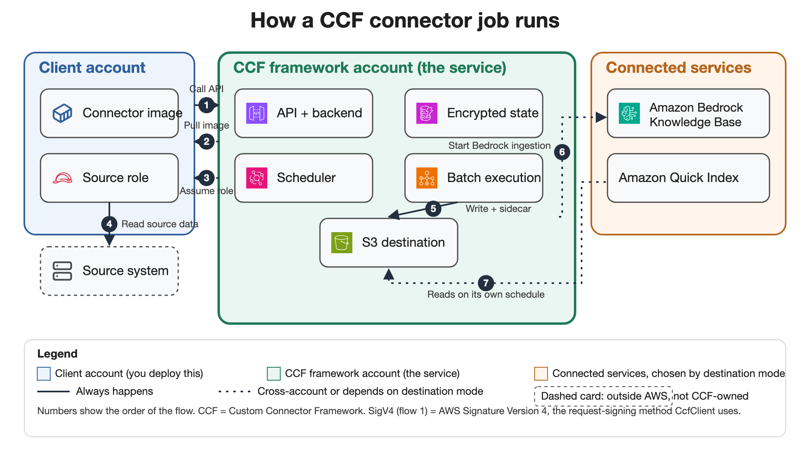
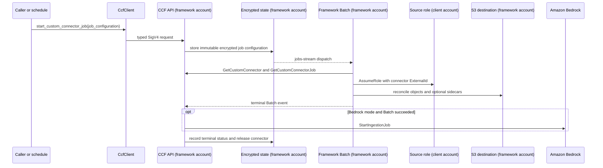
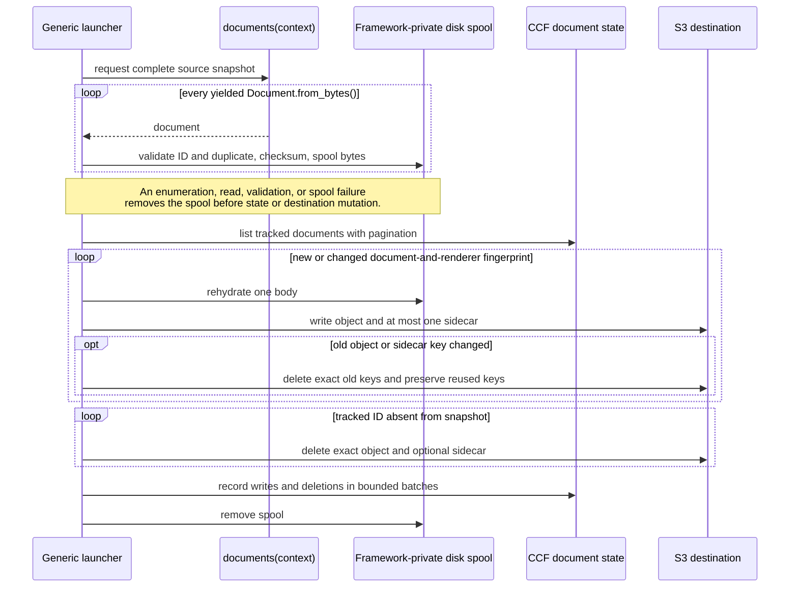

# Custom Connector Framework

The Custom Connector Framework (CCF) is a service for running custom data
connectors that feed an S3-backed knowledge base. A connector author writes
one function that returns the current set of documents from the source;
CCF owns everything else a connector normally has to reimplement: scheduling,
cross-account credentials, change tracking, destination writes, and triggering a managed
knowledge base after a successful run.

## Purpose

Writing a custom connector for a knowledge base usually means writing more
than the part that talks to the source. A connector also needs somewhere to
run on a schedule, a way to assume a role in whatever account holds the real
data, a way to tell which documents changed since the last run, a way to
write to the destination without putting credentials in connector code, and
a way to trigger ingestion after a successful run. None of that work has
anything to do with the actual source system, and it is the same work for
every connector.

CCF owns all of it. A connector author supplies a strict, frozen Pydantic
model for connector configuration, one for per-job configuration (or the
shared `EmptyJobConfiguration` when a job has no extra settings), and one
`documents(context)` function that yields the complete current snapshot of
documents from the source. CCF supplies the Amazon API Gateway endpoint,
[AWS Identity and Access Management (IAM)](https://aws.amazon.com/iam/) role
assumption, [AWS Key Management Service (AWS KMS)](https://aws.amazon.com/kms/)
encrypted configuration storage, [Amazon EventBridge
Scheduler](https://aws.amazon.com/eventbridge/) scheduling, [AWS
Batch](https://aws.amazon.com/batch/) execution, [Amazon Simple Storage
Service (Amazon S3)](https://aws.amazon.com/s3/) destination writes, and the
call that starts [Amazon Bedrock](https://aws.amazon.com/bedrock/) ingestion
or lets [Amazon Quick](https://aws.amazon.com/quick/) read the bucket on its
own schedule. Connector code never constructs a CCF client, selects a
destination, manages an object store, obtains AWS credentials, reports
deletions, or maintains a checkpoint; the toolkit does all of that around the
one function the author writes.

## High-level design

Smithy owns the control-plane contract. The API build generates an OpenAPI
document from the Smithy model, enriches it with [Amazon API
Gateway](https://aws.amazon.com/api-gateway/) request validation and [AWS
Signature Version 4 (SigV4)](https://docs.aws.amazon.com/IAM/latest/UserGuide/reference_sigv.html)
authorization, and generates strict Pydantic v2 request and response models
from it. CDK imports that OpenAPI document into `SpecRestApi`. The same
document also generates the private typed operations behind the one public
`CcfClient`, so connector code, client infrastructure, and the backend all
read from a single generated contract instead of three handwritten copies of
the same routes:

```text
Smithy -> OpenAPI -> strict Pydantic v2 models
                  -> private typed CcfClient operations
```

Figure 1 shows how a job actually runs once a connector is registered.



*Figure 1: In this figure, a client account owns the connector image and a
source-access role; the CCF framework account owns the API, scheduler,
encrypted state, Batch execution, and the S3 destination; connected services
are read or written depending on the configured destination mode.*

1. Register a connector, or start a job, through `CcfClient`.
2. AWS Batch pulls the registered connector image.
3. Batch assumes the connector's source role.
4. The connector reads source data using that role.
5. The connector writes documents and the optional sidecar to S3.
6. **(Optional)** Bedrock mode: start ingestion after a successful job.
7. **(Optional)** Quick mode: Amazon Quick Index reads the bucket on its own
   schedule.

This figure shows where each piece runs. [Figure 2](#starting-and-running-a-job)
in Workflows walks through flows 1, 3, and 6 as a full request sequence,
including the asynchronous dispatch between the API and Batch.

Document bytes never pass through the control-plane API. The toolkit writes
them to the destination bucket directly, and uses typed operations only for
configuration, job state, and document tracking.

## Workflows

Starting a job and reconciling a connector's document snapshot both run
inside the topology above.

### Starting and running a job

A manual `StartCustomConnectorJob` call and a scheduled run both enter the
same start activity. CCF owns each EventBridge Scheduler schedule and its
shared target in the framework account, so a connector carries no
client-owned scheduling resources. A scheduled run always starts with an empty
job configuration (`{}`), so a connector that runs on a schedule needs a job
configuration model that accepts `{}`, such as `EmptyJobConfiguration`. A
started job is persisted before its
DynamoDB stream record dispatches the orchestrator, which registers a Batch
job definition using the shared framework execution role (pulls the
registered image, writes logs) as `executionRoleArn` and a separate,
service-managed runtime role scoped to that one connector as `jobRoleArn`.
That per-connector runtime role is what the running container actually
holds, and it is what the control plane checks the caller's identity against
before honoring a tenant-delegated request. The running container receives
only the service endpoint, connector ID, tenant ARN prefix, job ID, and
Region, and fetches everything else through typed calls.



*Figure 2: In this figure, a solid arrow is a direct call and a dashed arrow
is an asynchronous event (a DynamoDB stream record or a terminal Batch
event); the `opt` box is the one step that only happens in Bedrock mode after
a successful job.*

### Fail-closed full-snapshot reconciliation

A connector's `documents(context)` function returns the complete current
snapshot, not an incremental diff. The toolkit turns that snapshot into
create, update, and delete operations the same way for every connector,
without connector-specific checkpoints.



*Figure 3: In this figure, the first loop is preflight: nothing is read from
CCF state or written to the destination until every document has been
validated and spooled. The note marks the fail-closed boundary: a failure
anywhere in that loop removes the spool and stops before touching state or
the destination. The remaining loops write changes, delete what is no longer
in the snapshot, and record the result.*

The document checksum covers identity, filename, metadata, and content.
Persisted reconciliation state combines that checksum with the adapter and
renderer revision, so a destination-mode change or a renderer change replaces
the exact prior object and sidecar without connector-specific code. An
identical rerun writes and deletes nothing. [`toolkit/README.md`](./toolkit/README.md#full-snapshot-behavior)
covers what happens when a write or delete fails partway through and why a
retry converges.

## Getting started

You need [uv](https://docs.astral.sh/uv/getting-started/installation/) and
Node.js 22 or 24. Deploying also needs a running container builder, because
synthesis builds the Lambda bundles and the connector image. CDK uses Docker by
default; to use [Finch](https://runfinch.com/), run `export CDK_DOCKER=finch`
before any `cdk` or `make` command. Clone the repository and install and verify
every subproject:

```bash
git clone <this repository>
cd sample-amazon-q-business-custom-connector-framework
make install
make check
```

`make install` installs every subproject's dependencies (`api`, `toolkit`,
`backend`, `cdk`, `samples`) with uv or npm, in the order each depends on the
last, and downloads the pinned Smithy CLI. `make check` runs lint,
type-check, and unit tests across every
subproject, including a check that the generated OpenAPI document,
Pydantic models, and typed client operations are still current with the
Smithy model.

To see a connector run without an AWS account, run the sample reconciliation
tests. They drive the real launcher against fake source APIs, an in-memory S3
client, and a fake CCF control plane:

```bash
make -C samples install
uv run --directory samples pytest -p no:cacheprovider tests/test_reconciliation.py -q
```

[`samples/README.md`](./samples/README.md#local-verification) lists what those
scenarios cover.

## Connector author contract

The [Purpose](#purpose) section lists what a connector author supplies.
Every configuration model sets `extra="forbid"`, `frozen=True`, and
`strict=True`, and every connector image runs the same launcher command:

```text
ccf-connector run module:definition
```

[`toolkit/README.md`](./toolkit/README.md) has the full contract and a
complete `ConnectorDefinition` example.

## Samples

The repository includes three connector definitions, indexed in
[`samples/README.md`](./samples/README.md):

- [`samples/github_connector`](./samples/github_connector) reads files, issues,
  and pull requests from multiple GitHub repositories.
- [`samples/gitlab_connector`](./samples/gitlab_connector) reads files, issues,
  and merge requests from multiple GitLab projects.
- [`samples/web_crawler`](./samples/web_crawler) reads a configured set of
  public HTTPS HTML and PDF pages.

## Destination behavior

The service response selects one destination mode for every connector in the
deployment:

| Mode      | Toolkit output                                                 | Service action after a successful job                                    |
| --------- | -------------------------------------------------------------- | -------------------------------------------------------------------------- |
| `S3`      | Document object                                                | None                                                                       |
| `BEDROCK` | Document object plus one Amazon Bedrock `.metadata.json` sidecar | Call `StartIngestionJob` for the deployed knowledge base and data source |
| `QUICK`   | Document object plus one Amazon Quick `.metadata.json` sidecar | None; Amazon Quick Index reads the configured bucket on its own schedule |

## Deploying this

The framework (the service itself) deploys once per environment; a client
stack deploys once per connector. [`cdk/README.md`](./cdk/README.md)
has the full deployment contract: the context values each deploy needs, what
each destination mode creates, and what the generic client stack does and
does not touch in the framework account. [The non-production Bedrock smoke
test](./docs/non-production-bedrock-smoke-test.md) walks through a complete
framework-plus-client deployment and job run end to end. Passing `make check`
locally does not prove a deployment or a managed-ingestion result.

## Operating this

[`docs/runbooks/delivery-failures.md`](./docs/runbooks/delivery-failures.md)
covers the framework's Scheduler target, jobs-table stream consumer, and
terminal Batch event target: how to tell P1 from P2, the likely causes, and
safe replay. Start there for an alarm on any of those paths.

## Project layout

Each subproject owns one part of the system and has its own README:

- [`api/`](./api) contains the Smithy model, generated OpenAPI document, strict
  Pydantic models, and client-operation generator.
- [`toolkit/`](./toolkit) contains the public connector contract, `CcfClient`,
  generic launcher, and private reconciliation, S3, and provider components.
- [`backend/`](./backend) contains control-plane activities, handlers, encryption,
  scheduling, execution, and state access.
- [`cdk/`](./cdk) contains the framework, client image-assets foundation, and
  API-only generic sample client stacks.
- [`samples/`](./samples) contains the GitHub, GitLab, and configured-page crawler
  definitions and local reconciliation tests.

## License

MIT-0. See [LICENSE](./LICENSE).
