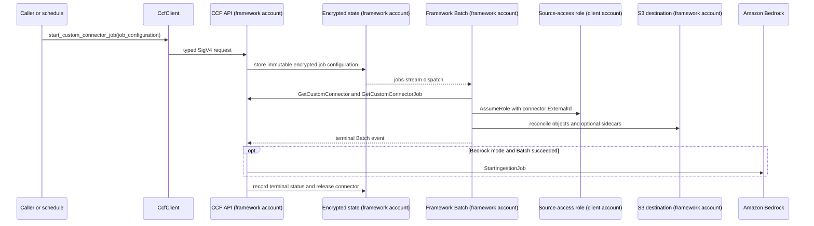

# Custom Connector Framework

Knowledge bases in [Amazon Bedrock](https://aws.amazon.com/bedrock/) and
[Amazon Quick](https://aws.amazon.com/quick/) include built-in connectors for
common sources such as SharePoint, Confluence, and Google Drive, but neither
service implements a connector for every system that holds an organization's
documents. A source without one, such as a GitHub repository or a GitLab
project, needs a custom connector. The Custom Connector Framework (CCF) is a
sample AWS service for building and running custom connectors. A connector
author writes the code that reads the source, and CCF runs that code on a
schedule or on demand, copies the documents it returns into the
[Amazon Simple Storage Service (Amazon S3)](https://aws.amazon.com/s3/) bucket
the knowledge base reads from, and removes the ones that disappeared from the
source.

## Purpose

A knowledge base gives a generative AI application access to an organization's
own documents. When someone asks a question, the knowledge base searches those
documents for relevant passages, and the application passes them to a foundation
model along with the question so the answer draws on that content. This
technique is called retrieval-augmented generation (RAG), and both
[Amazon Bedrock Managed Knowledge Bases](https://docs.aws.amazon.com/bedrock/latest/userguide/knowledge-base.html)
and
[knowledge bases in Amazon Quick](https://docs.aws.amazon.com/quick/latest/userguide/s3-integration.html)
use it.

A knowledge base can only search documents it has ingested, meaning read, split,
and indexed, and those documents start out in source systems such as code
repositories, issue trackers, and websites. A connector reads a source, copies
its documents into the knowledge base, and keeps that copy current as documents
are added, changed, and deleted. Both services can ingest documents from an
Amazon S3 bucket, so a custom connector can write its source's documents to S3
and let the knowledge base ingest them from there.

Reading the source is a small part of that custom connector. The connector also
needs somewhere to run on a schedule or on demand, credentials for the source, a
record of which documents changed since the last run, write access to the bucket
without credentials in connector code, and a way to start ingestion after it
writes. That code is the same for every connector, so CCF provides it once.

## Terminology

Knowledge base, RAG, ingestion, and connector are standard terms with the
meanings described in [Purpose](#purpose). CCF also depends on these AWS terms:

| AWS term                | Meaning                                                                                                                                                                                                                                                                                                                                                           |
| ----------------------- | ----------------------------------------------------------------------------------------------------------------------------------------------------------------------------------------------------------------------------------------------------------------------------------------------------------------------------------------------------------------- |
| Metadata file (sidecar) | A `<document>.metadata.json` file stored beside a document in S3 that carries the document's title, attributes, and access control list. Amazon Bedrock and Amazon Quick each define the format ([Bedrock](https://docs.aws.amazon.com/bedrock/latest/userguide/kb-metadata.html), [Quick](https://docs.aws.amazon.com/quick/latest/userguide/s3-metadata.html)). |
| Data source             | The Amazon Bedrock resource that tells a knowledge base which S3 bucket to ingest documents from.                                                                                                                                                                                                                                                                 |
| External ID             | A value that an IAM role's trust policy requires on every `AssumeRole` call, so only a caller that knows it can assume the role ([IAM docs](https://docs.aws.amazon.com/IAM/latest/UserGuide/id_roles_create_for-user_externalid.html)).                                                                                                                          |

The rest of this README uses CCF's own terms:

| CCF term                 | Meaning                                                                                                                                                                             |
| ------------------------ | ----------------------------------------------------------------------------------------------------------------------------------------------------------------------------------- |
| Framework account        | The AWS account where CCF is deployed. It runs the CCF API, state, schedules, connector compute, and the destination S3 bucket.                                                     |
| Client account           | An AWS account that registers connectors with CCF and holds their images and source-access roles.                                                                                   |
| Tenant                   | A client account as CCF sees it. CCF keys every connector, job, and S3 prefix by the tenant's account ID, so one tenant cannot reach another tenant's connectors or documents.      |
| Connector author         | The person who writes a custom connector's source-specific code.                                                                                                                    |
| Toolkit                  | The `custom_connector_framework` Python package that connector code imports.                                                                                                        |
| `CcfClient`              | The toolkit's typed Python client for the CCF API.                                                                                                                                  |
| Connector definition     | The `ConnectorDefinition` value that binds a connector's configuration models and its `documents(context)` generator.                                                               |
| Launcher                 | The `ccf-connector` command every connector image runs. It loads the connector definition, fetches configuration, assumes the source-access role, and runs reconciliation.          |
| Job                      | One run of a connector, started on demand or by the connector's schedule.                                                                                                           |
| Snapshot                 | Every document the source holds when a job runs, as yielded by `documents(context)`.                                                                                                |
| Reconciliation           | Comparing a snapshot with the documents recorded on the last job, then writing and deleting S3 objects to match.                                                                    |
| Source-access role       | An IAM role in the client account that the connector assumes, with the connector's external ID, to read source credentials.                                                         |
| Framework execution role | The shared role that AWS Batch uses to pull connector images and write logs. Connector code never holds it.                                                                         |
| Runtime role             | A role CCF creates for each connector at registration. The connector container runs as it, and it can reach only that connector's API resources, S3 prefix, and source-access role. |
| Destination mode         | The deploy-time setting, `S3`, `BEDROCK`, or `QUICK`, that decides which sidecar the toolkit writes and what CCF does after a successful job.                                       |
| Client stack             | The AWS CDK stack that deploys one connector's image and source-access role into its client account and registers the connector with CCF.                                           |

## Writing a connector

A connector author writes a [Pydantic](https://docs.pydantic.dev/) model for
connector configuration, such as the GitHub repositories to read and the
[AWS Secrets Manager](https://aws.amazon.com/secrets-manager/) ARN of the access
token, and a second model for job configuration. A connector whose jobs take no
settings uses the shared `EmptyJobConfiguration` instead. Each model sets
`extra="forbid"`, `frozen=True`, and `strict=True`, so a misspelled or mistyped
field fails validation instead of being ignored. The author also writes a
`documents(context)` generator that yields the snapshot as
`Document.from_bytes()` values, and binds the models and the generator in a
`ConnectorDefinition`. The author packages the connector as a container image,
and every connector image starts the launcher with the same command:

```text
ccf-connector run module:definition
```

[`toolkit/README.md`](./toolkit/README.md#author-contract) has the full contract
and a complete example.

## High-level design

Everything in CCF runs in the framework account except what each client account
owns, which is the connector image, stored in
[Amazon Elastic Container Registry (Amazon ECR)](https://aws.amazon.com/ecr/),
and the source-access role. A client account can be the framework account
itself, which is how the sample deploy commands run, or another account that the
framework deployment admits with its `allowedClientAccountIds` setting.

The source-access role reads source credentials, such as a GitHub token stored
in Secrets Manager. Its
[AWS Identity and Access Management (IAM)](https://aws.amazon.com/iam/) trust
policy requires the connector's external ID, which the client supplies when it
registers the connector, so no other caller can use CCF to assume the role.

Clients call CCF through `CcfClient`, which sends
[AWS Signature Version 4 (SigV4)](https://docs.aws.amazon.com/IAM/latest/UserGuide/reference_sigv.html)
signed requests to an [Amazon API Gateway](https://aws.amazon.com/api-gateway/)
API in the framework account. Behind that API,
[AWS Lambda](https://aws.amazon.com/lambda/) functions handle requests and
dispatch jobs,
[Amazon EventBridge Scheduler](https://aws.amazon.com/eventbridge/scheduler/)
starts scheduled runs, [Amazon DynamoDB](https://aws.amazon.com/dynamodb/)
stores connector and job state with configuration encrypted under an
[AWS Key Management Service (AWS KMS)](https://aws.amazon.com/kms/) key, and
[AWS Batch](https://aws.amazon.com/batch/) runs the connector image.

Each framework deployment creates its own S3 bucket and writes documents to it
in one destination mode, chosen at deploy time. The destination mode decides
which sidecar the toolkit writes beside each document and what CCF does after a
successful job:

| Mode      | Toolkit output                                                   | Service action after a successful job                                    |
| --------- | ---------------------------------------------------------------- | ------------------------------------------------------------------------ |
| `S3`      | Document object                                                  | None                                                                     |
| `BEDROCK` | Document object plus one Amazon Bedrock `.metadata.json` sidecar | Call `StartIngestionJob` for the deployed knowledge base and data source |
| `QUICK`   | Document object plus one Amazon Quick `.metadata.json` sidecar   | None; Amazon Quick Index reads the configured bucket on its own schedule |


_Figure 1: How a CCF connector job runs across the client and framework
accounts._

1. Register a connector, or start a job, through `CcfClient`.
2. AWS Batch pulls the registered connector image.
3. The connector, running in Batch, assumes the source-access role with its
   external ID.
4. The connector reads source data using that role.
5. The connector writes documents and the optional sidecar to S3.
6. **(Optional)** Bedrock mode: start ingestion after a successful job.
7. **(Optional)** Quick mode: Amazon Quick Index reads the bucket on its own
   schedule.

The toolkit writes document bytes directly to the S3 bucket, so large files
never run into the API Gateway request size limit. The API carries only
configuration, job state, and document tracking.

## Workflows

A job starts in the service, which dispatches it to Batch, and the toolkit
inside the connector container reconciles the source with the destination.

### Starting and running a job

A manual `StartCustomConnectorJob` call and a scheduled run go through the same
start path. Setting a connector's `schedule` field on create or update makes CCF
create an EventBridge Scheduler schedule for it. A scheduled run sends `{}` as
its job configuration, so a connector that runs on a schedule needs a job
configuration model that accepts `{}`, such as `EmptyJobConfiguration`.

CCF stores the job with its encrypted configuration, and the job's DynamoDB
stream record triggers a job orchestrator Lambda function. The orchestrator
registers a Batch job definition that uses the framework execution role to pull
the image and write logs, and runs the container as the connector's runtime
role. The container receives the service endpoint, connector ID, tenant ARN
prefix, job ID, and Region, and fetches its configuration through `CcfClient`.
The API acts on that tenant ARN prefix only when the SigV4 caller is the
connector's runtime role.



_Figure 2: Starting and running a job. Solid arrows are direct calls, and dashed
arrows are asynchronous events._

### Fail-closed full-snapshot reconciliation

`documents(context)` yields the snapshot. The toolkit compares it with the
documents recorded on the last job, then writes new and changed documents and
deletes the ones that disappeared. Before it reads tracked state or touches the
destination, the toolkit validates every document and spools it to a private
disk directory, so a source failure partway through the snapshot leaves the
destination as it was.


_Figure 3: Reconciling a source snapshot with the destination._

A document's checksum covers its ID, filename, metadata, and content, and
tracked state also records the destination mode and sidecar format that wrote
it. A rerun with no source changes writes and deletes nothing. A changed
document, a destination-mode change, or a sidecar format change replaces the
exact old object and sidecar.
[`toolkit/README.md`](./toolkit/README.md#full-snapshot-behavior) covers what
happens when a write or delete fails partway through and why a retry converges.

## Samples

[`samples/README.md`](./samples/README.md) indexes the sample connectors:

- [`samples/github_connector`](./samples/github_connector) reads files, issues,
  and pull requests from multiple GitHub repositories.
- [`samples/gitlab_connector`](./samples/gitlab_connector) reads files, issues,
  and merge requests from multiple GitLab projects.
- [`samples/web_crawler`](./samples/web_crawler) reads a configured set of
  public HTTPS HTML and PDF pages.

## Getting started

You need [uv](https://docs.astral.sh/uv/getting-started/installation/) and
Node.js 22 or 24. The infrastructure is written with the
[AWS Cloud Development Kit (AWS CDK)](https://aws.amazon.com/cdk/), and
deploying it needs a container builder, because CDK synthesis builds the Lambda
function bundles and the connector image. CDK uses Docker by default. To use
[Finch](https://runfinch.com/) instead, run `export CDK_DOCKER=finch` before any
`cdk` or `make` command. Clone the repository, then install and check every
subproject:

```bash
git clone https://github.com/aws-samples/sample-custom-connector-framework-for-knowledge-bases.git
cd sample-custom-connector-framework-for-knowledge-bases
make install
make check
```

The CCF API is defined in a [Smithy](https://smithy.io/) model in
[`api/model`](./api/model), and the build generates the OpenAPI document,
Pydantic models, and `CcfClient` operations from it. `make install` installs the
dependencies for `api`, `toolkit`, `backend`, `cdk`, and `samples` in dependency
order and downloads the pinned Smithy CLI. `make check` runs lint, type checks,
and unit tests in each subproject, and fails if the generated files are out of
date with the Smithy model.

To see a connector run without an AWS account, run the sample reconciliation
tests. They drive the real launcher against fake source APIs, an in-memory S3
client, and a fake CCF API:

```bash
make -C samples install
uv run --directory samples pytest -p no:cacheprovider tests/test_reconciliation.py -q
```

[`samples/README.md`](./samples/README.md#local-verification) lists what those
scenarios cover.

## Deploying this

The framework deploys once per environment, and each connector gets its own
client stack. [`cdk/README.md`](./cdk/README.md) covers the context values each
deploy needs, what each destination mode creates, and how to deploy your own
connector with the generic client stack.
[The non-production Bedrock smoke test](./docs/non-production-bedrock-smoke-test.md)
deploys the framework and the crawler client stack, runs a job, and checks
Bedrock ingestion.

## Operating this

Every framework alarm links to
[`docs/runbooks/delivery-failures.md`](./docs/runbooks/delivery-failures.md),
which covers severity, likely causes, and safe replay for the Scheduler target,
the DynamoDB stream that triggers the job orchestrator, and the target that
receives terminal Batch job events.

## Project layout

Each subproject has its own README:

- [`api/`](./api) contains the Smithy model, the generated OpenAPI document and
  Pydantic models, and the `CcfClient` operation generator.
- [`toolkit/`](./toolkit) contains the connector author contract, `CcfClient`,
  the launcher, and the private reconciliation, S3, and destination-mode
  components.
- [`backend/`](./backend) contains the Lambda handlers behind the CCF API and
  their encryption, scheduling, job execution, and state access.
- [`cdk/`](./cdk) contains the framework stack, the client image-assets
  foundation stack, the generic client stack, and the sample app.
- [`samples/`](./samples) contains the GitHub, GitLab, and configured-page
  crawler definitions and local reconciliation tests.

## License

MIT-0. See [LICENSE](./LICENSE).
