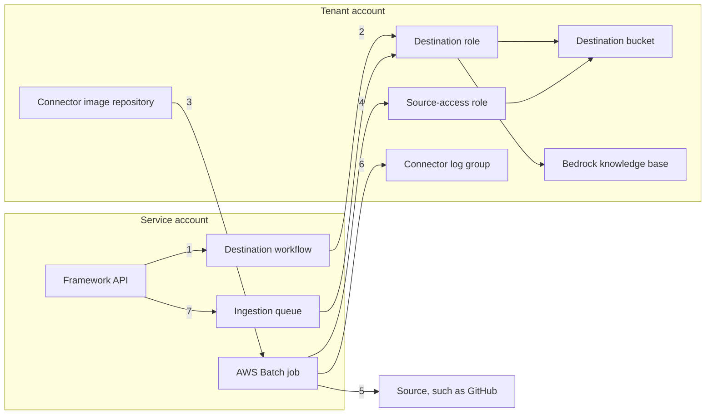

# Custom Connector Framework

Amazon Bedrock knowledge bases and Amazon Quick come with connectors for common
sources, but not for every system a team keeps its documents in. Both can ingest
an Amazon S3 bucket, so any source can reach them if something keeps a current
copy of its documents in a bucket. The Custom Connector Framework (CCF) is a
sample that runs the code you write for such a source in AWS Batch, on a
schedule or on demand. Each job writes new and changed documents to a bucket in
your account and deletes the ones the source no longer has. Bedrock then
indexes them.

This repository holds the framework and one complete connector, for public
GitHub repositories. The walkthrough below deploys both in one account, runs a
job, and searches the indexed files with Amazon Bedrock `Retrieve` at the end.

## Concepts

The walkthrough uses these terms. [DESIGN.md](./DESIGN.md#glossary)
defines every term with an example.

| Term | Meaning |
| --- | --- |
| Service account | The AWS account the framework is deployed in. It runs the API, the job compute, and the workflows. |
| Tenant account | The AWS account that owns destinations and registers custom connectors. The walkthrough uses one account as both. |
| Destination | A bucket in the tenant account and, for type `BEDROCK`, a knowledge base and data source that read it. The framework creates it for you. |
| Custom connector | A registered instance of your connector code: its container image, configuration, secret, schedule, and the destination it writes to. |
| Job | One run of a custom connector. |
| Connector implementation | Your code: one Python class whose `run()` reads the source and writes through the toolkit's `DocumentStore`. |
| Toolkit | The `custom_connector_framework` Python package your code imports, and the CDK constructs your stacks use. |
| Destination stack | The `CustomConnectorDestinationFor<Name>` stack the framework's CDK app deploys for one destination. It creates the destination's role in your account, `CcfDestinationRole-<name>`, and the destination. |

## How it works

Figure 1 shows the parts and the order a job uses them in.



_Figure 1: The service account runs the API, the workflows, and the jobs. Every
resource in the tenant account is reached through a role in that account._

1. You call `CreateDestination`, and the framework starts its destination
   workflow.
1. The workflow assumes the destination's role in your account and creates the
   bucket and, for `BEDROCK`, the knowledge base and data source.
1. A job starts on its schedule or when you call `StartCustomConnectorJob`.
   AWS Batch pulls your connector image from the repository in your account.
1. The toolkit in the container assumes the custom connector's source-access
   role in your account. It reads the secret and writes documents to the bucket
   with that role.
1. Your implementation reads the source.
1. When the custom connector has a log destination, everything the container
   prints goes to a log group in your account.
1. After a successful job on a `BEDROCK` destination, the framework queues an
   ingestion request. Its consumer calls Bedrock's `StartIngestionJob` through
   the destination's role.

## Walkthrough: from deploy to search

The walkthrough uses one AWS account as both the service account and the
tenant account. A tenant in another account follows the same steps with the
framework's values in its configuration, as the
[administrator guide](./docs/administrator-guide.md#deploy-a-tenant-in-another-account)
describes.

### Prerequisites

You need these before you start:

- An AWS account, credentials for it in your shell, and a Region where Amazon
  Bedrock knowledge bases are available.
- The account and Region bootstrapped for the AWS CDK
  (`npx cdk bootstrap aws://<account>/<region>`).
- [uv](https://docs.astral.sh/uv/getting-started/installation/), Node.js 22 or
  24, and the AWS CLI.
- A running container builder. CDK uses Docker. To use
  [Finch](https://runfinch.com/), run `export CDK_DOCKER=finch` in the shell
  you deploy from.
- A GitHub personal access token that can read public repositories.

### Step 1: Install and check the code

This step builds every project and runs its tests on your machine.

1. Clone the repository and install every project:

   ```bash
   git clone https://github.com/aws-samples/sample-amazon-q-business-custom-connector-framework.git
   cd sample-amazon-q-business-custom-connector-framework
   make install
   ```

1. Run the lint, type checks, and unit tests:

   ```bash
   make check
   ```

   The command ends with exit status 0.

### Step 2: Deploy the framework

The framework's two stacks go into your account first, because the
destination and connector stacks read their exports.

1. Deploy the framework stacks with the default configuration:

   ```bash
   make -C framework deploy
   ```

   This deploys `CustomConnectorFramework`, then `CustomConnectorFrameworkOps`.
   The default configuration (`framework/cdk/config/default.json`) admits only
   the service account as a tenant and retains tables and log groups when a
   stack is deleted.

1. Subscribe to the alarm topic, so you hear about failures. The topic's ARN is
   the `AlarmTopicArnExport` output of `CustomConnectorFrameworkOps`:

   ```bash
   aws cloudformation describe-stacks --stack-name CustomConnectorFrameworkOps \
     --query "Stacks[0].Outputs[?OutputKey=='AlarmTopicArnExport'].OutputValue" --output text
   ```

### Step 3: Deploy the GitHub connector

A connector writes into a destination: a bucket and the knowledge base that
ingests it. The destination gets its own stack, so you can delete or replace the
connector without losing the index. The default GitHub configuration creates
three custom connectors, one each for the `aws-samples`, `awslabs`, and `aws`
organizations, and reads up to 300 repositories from each. To try it with less,
copy `connectors/github/cdk/config/example-small.json`, which reads 5
repositories of `aws-samples`.

1. Deploy the destination:

   ```bash
   make -C framework/cdk deploy DESTINATION_CONFIG=config/destination-github.json
   ```

   This deploys `CustomConnectorDestinationForGitHub`, a `BEDROCK` destination
   named `GitHub`. The deployment waits until the destination is `ACTIVE`, which
   can take several minutes. Note its `DestinationId` output, and set it as
   `destination.id` in your GitHub configuration file.

1. Deploy the connector:

   ```bash
   make -C connectors/github deploy CONFIG=config/<your file>.json
   ```

   `GitHubCustomConnector` builds the connector image, creates the token
   secret, and registers one custom connector per owner, named
   `github-<owner>`. Each gets a weekly schedule, a source-access role, and a
   log group.

1. Read the outputs you need in the next steps:

   ```bash
   aws cloudformation describe-stacks --stack-name CustomConnectorDestinationForGitHub --query "Stacks[0].Outputs"
   aws cloudformation describe-stacks --stack-name GitHubCustomConnector --query "Stacks[0].Outputs"
   aws cloudformation describe-stacks --stack-name CustomConnectorFramework \
     --query "Stacks[0].Outputs[?OutputKey=='ApiEndpoint'].OutputValue" --output text
   ```

   From the destination stack, note `KnowledgeBaseId` and `DataSourceId`. From
   `GitHubCustomConnector`, note `GitHubTokenSecretArn` and a connector ID, such
   as `ConnectorIdawssamples` for the `aws-samples` organization. The last
   command prints the framework's API endpoint.

1. Store your GitHub token in the secret. `read -rs` keeps it out of your shell
   history:

   ```bash
   read -rs GITHUB_TOKEN
   aws secretsmanager put-secret-value --secret-id "<GitHubTokenSecretArn>" \
     --secret-string "$GITHUB_TOKEN"
   unset GITHUB_TOKEN
   ```

### Step 4: Run a job

The framework API takes requests signed with AWS Signature Version 4. The
toolkit's `CcfClient` signs them with your credentials.

1. Export the values from step 3:

   ```bash
   export CCF_ENDPOINT="<ApiEndpoint>"
   export CCF_REGION="<your Region>"
   export DESTINATION_ID="<DestinationId>"
   export CONNECTOR_ID="<ConnectorIdawssamples>"
   ```

1. Start a job and wait until it ends:

   ```bash
   uv run --directory framework/toolkit python - <<'EOF'
   import os
   import time

   import boto3
   from ccf_api_models.models import GetCustomConnectorJobRequest, StartCustomConnectorJobRequest
   from custom_connector_framework import CcfClientSettings, create_ccf_client

   client = create_ccf_client(
       CcfClientSettings(
           endpoint=os.environ["CCF_ENDPOINT"],
           region=os.environ["CCF_REGION"],
           session=boto3.Session(region_name=os.environ["CCF_REGION"]),
       )
   )
   ids = {"destination_id": os.environ["DESTINATION_ID"], "connector_id": os.environ["CONNECTOR_ID"]}
   job = client.start_custom_connector_job(StartCustomConnectorJobRequest(**ids)).job
   print("started", job.job_id)
   while True:
       job = client.get_custom_connector_job(GetCustomConnectorJobRequest(**ids, job_id=job.job_id)).job
       if job.status in ("SUCCEEDED", "FAILED", "STOPPED"):
           print(job.status, job.status_reason or "")
           break
       time.sleep(30)
   EOF
   ```

   The job reads each repository's archive, so the first run of a large
   organization takes a while. It prints `SUCCEEDED` when it ends.

1. If the job prints `FAILED`, its `status_reason` says why. For a failure in
   the connector code, it names the log group and stream to read, for example
   `ConnectorImplementationError: see log group /ccf/connectors/github-aws-samples, stream ccj-0fdef5d64630`.
   Read the stream with:

   ```bash
   aws logs tail /ccf/connectors/github-aws-samples --log-stream-names "<job ID>"
   ```

   The GitHub configuration turns on log delivery by default. Without a log
   destination, nothing the container prints is kept. The
   [administrator guide](./docs/administrator-guide.md#troubleshoot-a-failed-job)
   lists every `status_reason`.

### Step 5: Search the knowledge base

A successful job ends with the framework asking Bedrock to index the new
documents, so search works once that ingestion finishes.

1. Check that the ingestion finished:

   ```bash
   aws bedrock-agent list-ingestion-jobs --knowledge-base-id "<KnowledgeBaseId>" \
     --data-source-id "<DataSourceId>" --query "ingestionJobSummaries[0].status"
   ```

   The command prints `"COMPLETE"` when the documents are indexed.

1. Search the indexed documents with `Retrieve`:

   ```bash
   aws bedrock-agent-runtime retrieve --knowledge-base-id "<KnowledgeBaseId>" \
     --retrieval-query '{"text": "Step Functions workflow that calls Amazon Bedrock"}' \
     --query "retrievalResults[].{score: score, uri: metadata.source_uri}"
   ```

   Each result is a passage from a repository file, with its score and the
   file's GitHub URL.

### Step 6: Clean up

Delete the stacks in the reverse order of the deploy, waiting for each one.
CloudFormation refuses to delete a stack whose exports another stack still
imports.

```bash
for stack in GitHubCustomConnector CustomConnectorDestinationForGitHub CustomConnectorFrameworkOps CustomConnectorFramework; do
  aws cloudformation delete-stack --stack-name "$stack"
  aws cloudformation wait stack-delete-complete --stack-name "$stack"
done
```

Deleting `GitHubCustomConnector` deletes each custom connector's documents
from the destination. `config/destination-github.json` sets `removalPolicy` to
`RETAIN`, so deleting `CustomConnectorDestinationForGitHub` keeps the
destination, its role, and its index. The default configurations also retain
the framework's tables, the image repository, the token secret, and the log
groups. The [administrator guide](./docs/administrator-guide.md#tear-down)
lists what stays and how to delete it.

## Where to go next

Each guide covers one reader's task:

- [docs/administrator-guide.md](./docs/administrator-guide.md): configuration,
  deploying tenants in other accounts, roles, monitoring, troubleshooting, and
  teardown.
- [docs/user-guide.md](./docs/user-guide.md): the API, writing a connector
  implementation, the document store, and checkpoints.
- [DESIGN.md](./DESIGN.md): the glossary, components, workflows, and decisions.

## Repository layout

| Path | What it holds |
| --- | --- |
| [`framework/`](./framework) | The framework: the [API model](./framework/api), the [Lambda backend](./framework/backend), the [toolkit](./framework/toolkit), the [CDK app and connector constructs](./framework/cdk), and the [runbooks](./framework/docs/runbooks) its alarms link to. |
| [`connectors/github/`](./connectors/github) | The GitHub connector: its implementation and image, and the CDK app with the `GitHubCustomConnector` stack. |
| [`docs/`](./docs) | The administrator guide and the user guide. |

`make install`, `make check`, `make test`, `make build`, `make fix`, and
`make clean` at the root run the same target in `framework/`, then in
`connectors/github/`. The root `make check` also scans the working tree with
[gitleaks](https://github.com/gitleaks/gitleaks). `make deploy` deploys the
framework, a destination, and the GitHub connector in that order, given
`FRAMEWORK_CONFIG`, `DESTINATION_CONFIG`, and `GITHUB_CONFIG`.

## Security

See [CONTRIBUTING](./CONTRIBUTING.md#security-issue-notifications) for more
information.

## License

This library is licensed under the MIT-0 License. See the [LICENSE](./LICENSE)
file.
