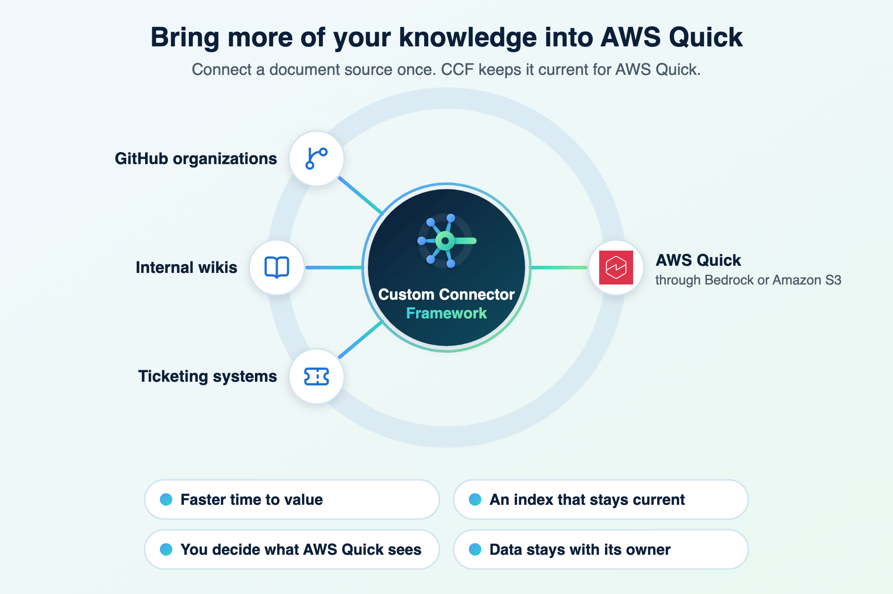
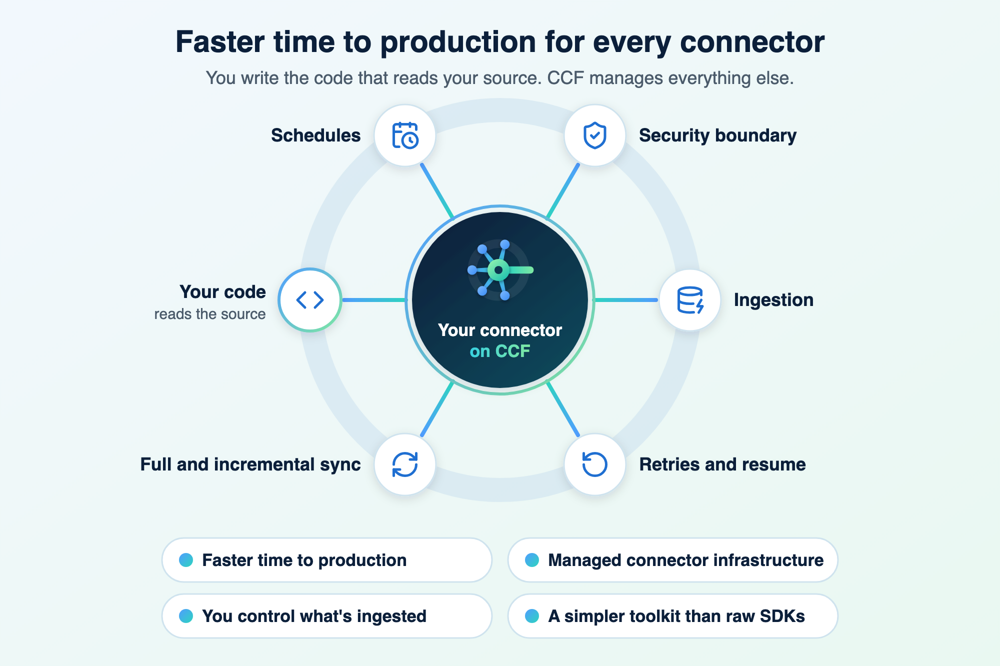
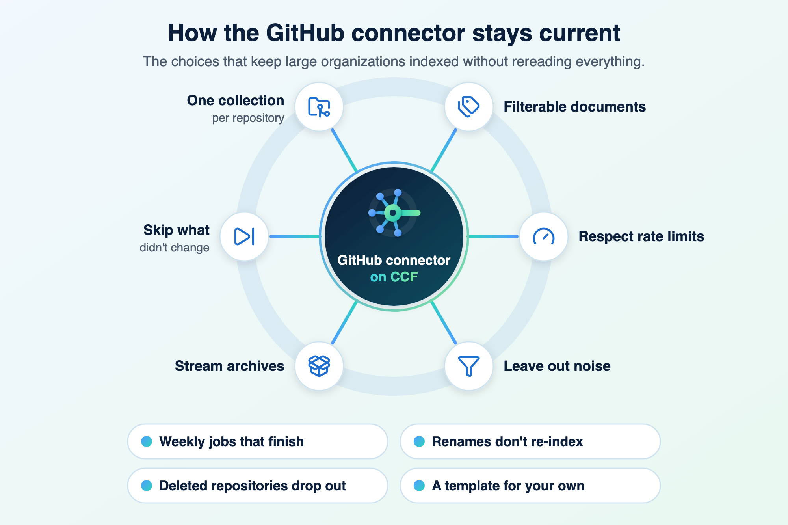
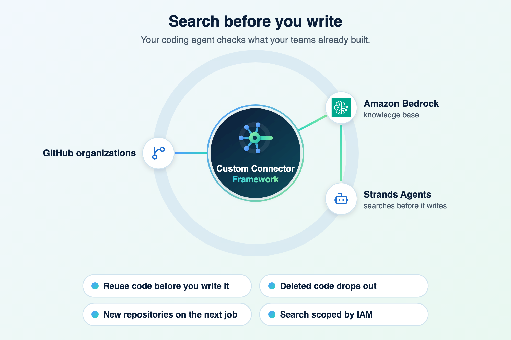

# Blog

The Custom Connector Framework (CCF) is an open source AWS sample that simplifies building, running, and operating document ingestion from any document source into [Amazon Bedrock knowledge bases](https://aws.amazon.com/bedrock/knowledge-bases/), [AWS Quick](https://aws.amazon.com/quick/), or [Amazon S3](https://aws.amazon.com/s3/). You write the code that reads your source. CCF manages everything else.

These posts show what that makes possible for your teams. Each one builds on the example GitHub connector, which indexes the public repositories of the GitHub organizations you choose.

## [Bring any document source into AWS Quick with a custom connector](aws-quick.md)

Index a document source that AWS Quick has no connector for, through an Amazon Bedrock knowledge base or the Amazon S3 integration in AWS Quick.

[{ width="480" }](aws-quick.md)

## [Build a custom connector for any document source](build-a-connector.md)

Write only the code that reads your source, and let CCF manage the schedule, full and incremental syncs, and the security boundary, while your data stays in your account.

[{ width="480" }](build-a-connector.md)

## [Inside the GitHub connector: a custom connector example](github-connector.md)

The design choices that let the example connector keep up with large GitHub organizations, and that apply to most sources.

[{ width="480" }](github-connector.md)

## [Let Strands Agents find the code your teams already wrote](strands-agents.md)

Give an agent built with Strands Agents a search tool over your organizations' repositories, so it reuses code before it writes new code.

[{ width="480" }](strands-agents.md)
